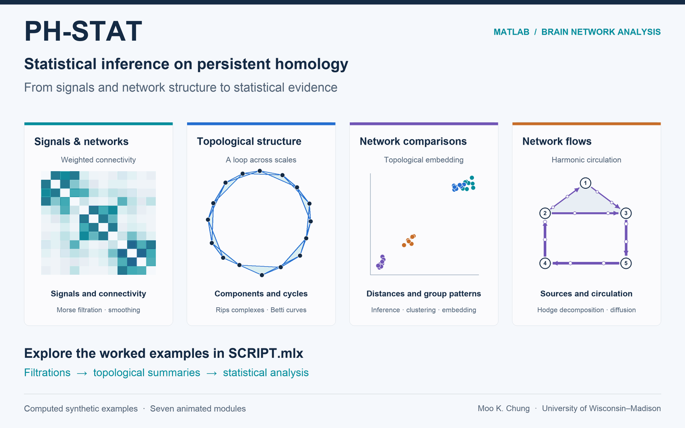

# PH-STAT: Statistical Inference on Persistent Homology

**A MATLAB toolbox for statistical analysis of network topology, with an emphasis on brain networks.**

The toolbox is currently under development and is approximately 20% complete. A Python version is planned once the MATLAB toolbox reaches 50% completion.
PH-STAT connects the structure of signals and networks to statistical questions: how networks differ between groups, how their organization changes across scales, and how edge flows separate into source–sink and cyclic components. The MATLAB Live Script [`SCRIPT.mlx`](https://github.com/laplcebeltrami/PH-STAT/blob/main/SCRIPT.mlx), provides worked examples with code, explanations, and visualizations.



*The animation uses computed synthetic examples adapted from `SCRIPT.mlx` ([read how the animation was generated](assets/workflow/ANIMATION.md)).*

## What the toolbox does currently

| Capability | Research question or output | Main functions |
| --- | --- | --- |
| **Morse filtration** | Which features of a one-dimensional signal persist across levels? Smooth signals and construct persistence diagrams. | `WFS_COS`, `PH_morse1D`, `PH_PD_display` |
| **Simplicial complexes** | How do connected components, loops, and higher-order structures emerge? Construct Rips complexes, boundary matrices, and Betti numbers. | `PH_rips`, `PH_connectivity2simplex`, `PH_boundary`, `PH_boundary_betti` |
| **Graph filtrations** | How does network topology vary across edge-weight thresholds? Track connected components and independent cycles. | `PH_betti`, `PH_betti_display`, `PH_graph_betti_display` |
| **Topological inference and embedding** | Do groups differ in network topology? Compare birth/death features using Wasserstein-based distances, group statistics, label randomization, and two-dimensional summaries. | `WS_decompose`, `WS_pdist2`, `WS_ratio`, `WS_transpositions`, `WS_embed` |
| **Topological clustering** | Which networks have similar topological structure? Compare clustering methods using simulations with known generating groups. | `WS_cluster`, `WS_bottleneck_cluster`, `GH_cluster`, `clustering_comparions` |
| **Covariate and site-effect assessment** | Does topology vary across categorical covariate groups or imaging sites? The Live Script includes pairwise site comparisons and false discovery rate correction. | `WS_pdist2`, `WS_ratio`, `WS_transpositions`, `FDR` |
| **Network Hodge theory** | How do directed edge signals separate into source–sink variation, local circulation, and harmonic flow? Decompose signals and visualize edge diffusion. | `Hodge_1Skeleton`, `Hodge_2Skeleton`, `Hodge_decompose`, `Hodge_diffusion_plot`, `Hodge_diffusion_animate` |

## Get started

1. Download this repository using **Code → Download ZIP**, or clone it, and open the repository folder in MATLAB.
2. Add the folder to the MATLAB path and open the Live Script:

   ```matlab
   addpath(pwd)
   open('SCRIPT.mlx')
   ```

3. Run the sections of interest in order, including preceding sections that create their inputs. The script covers signal analysis, simplicial complexes, graph filtrations, inference, clustering, site comparisons, and network Hodge theory.

**Requirements:** MATLAB. Examples using functions such as `normrnd`, `pdist2`, and `kmeans` require the Statistics and Machine Learning Toolbox. Some simulation and permutation sections perform many iterations; their settings are explained in the Live Script.

**Inputs and outputs:** Examples use sampled signals, point coordinates, weighted connectivity matrices, and edge-flow signals. Outputs include persistence summaries, Betti curves, distance matrices, test statistics and p-values, embeddings, clustering summaries, and Hodge components. For instance, `WS_pdist2` returns **squared** topological distances in `D0`, `D1`, and `D01`.

## Documentation and tutorials

- [PH-STAT manual — arXiv:2304.05912](https://arxiv.org/abs/2304.05912), revised July 2026; [repository PDF](https://github.com/laplcebeltrami/PH-STAT/blob/main/PH-STAT.pdf).
- [Tutorial on Topological Data Analysis in Connectomics](https://github.com/laplcebeltrami/PH-STAT/blob/main/ISMI-tutorial-2026.09.17.pdf), Institute for Mathematical and Statistical Innovation (IMSI), The University of Chicago, September 17, 2026.
- [Topological Data Analysis with PH-STAT](https://github.com/laplcebeltrami/PH-STAT/blob/main/TDA-tutorial.pdf), Short Course on Topological and Object-Oriented Data Analysis, 33rd International Biometric Conference (IBC), July 12, 2026.

## Scientific basis and citation

Please cite [Chung, *PH-STAT*, arXiv:2304.05912](https://arxiv.org/abs/2304.05912) when using the toolbox, examples, or data, together with the relevant methodological papers identified in `SCRIPT.mlx` and the function headers. Examples include:

- Songdechakraiwut and Chung (2023). [Topological learning for brain networks](https://arxiv.org/abs/2012.00675). *Annals of Applied Statistics*, 17, 403–433.
- Chung et al. (2023). [Unified topological inference for brain networks in temporal lobe epilepsy using the Wasserstein distance](https://arxiv.org/abs/2302.06673). *NeuroImage*, 284, 120436.
- Chung et al. (2024). [Topological state-space estimation of functional human brain networks](https://doi.org/10.1371/journal.pcbi.1011869). *PLOS Computational Biology*, 20(5), e1011869.
- Anand and Chung (2023). [Hodge Laplacian of brain networks](https://arxiv.org/abs/2110.14599). *IEEE Transactions on Medical Imaging*, 42(5), 1563–1573.

## Development and contact

PH-STAT is an actively developed research toolbox. The modules above are represented in the current Live Script; additional functionality and refinements are under development. Feedback, reproducible bug reports, and requests for specific functionality are welcome through [GitHub Issues](https://github.com/laplcebeltrami/PH-STAT/issues) or **mkchung at wisc dot edu**.

© 2023– Moo K. Chung, University of Wisconsin–Madison.
